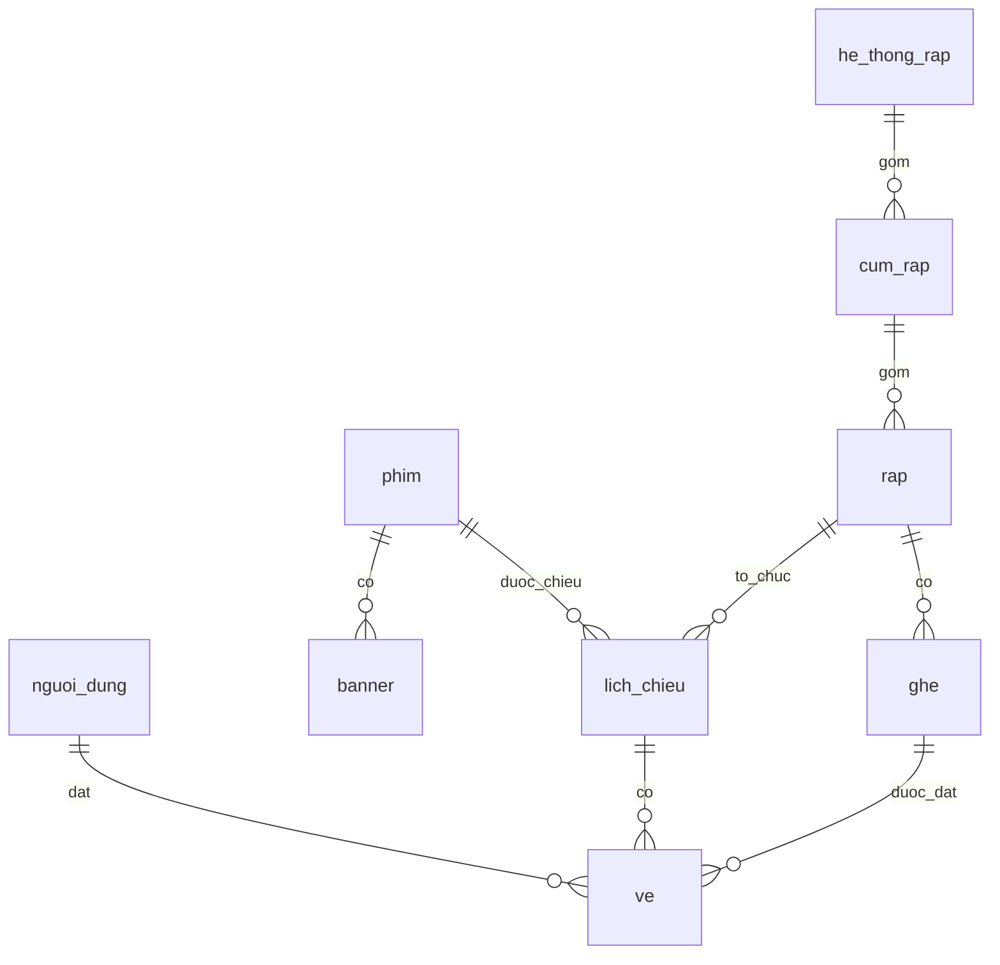

# Dự án cuối khóa NodeJS — Movie API

Triển khai 30 thao tác HTTP thuộc 29 đường dẫn của [Swagger Movie CyberSoft](https://movienew.cybersoft.edu.vn/swagger/index.html), theo đề capstone. Dùng ExpressJS + Prisma Client + MySQL. Không yêu cầu TokenCybersoft. Source được đặt trong thư mục `duancuoikhoa` của branch cùng tên trong repo `nodejs56`.

## Chạy trên máy hiện tại

Yêu cầu Node.js >= 22, MySQL >= 8.0.16. Chạy các lệnh trong thư mục dự án:

```powershell
npm ci
npm run db:init
npm start
```

Mở Swagger tại http://localhost:3000/swagger, kiểm tra kết nối tại http://localhost:3000/health. Có thể dùng `npm run dev` để tự khởi động lại khi sửa code.

[.env](./.env) trên máy đã được cấu hình với host `127.0.0.1`, port `3307`, user `root`, database `duancuoikhoa` và mật khẩu bạn cung cấp. File này bị Git bỏ qua. Tài khoản quản trị là `admin`, mật khẩu nằm ở biến `ADMIN_PASSWORD` trong file đó. JWT secret và mật khẩu admin được tạo ngẫu nhiên; không có tài khoản quản trị mặc định công khai.

## Cài trên máy khác

1. Tải branch `duancuoikhoa`, vào thư mục `duancuoikhoa` và chạy `npm ci`.
2. Sao chép [.env.example](./.env.example) thành `.env`, điền kết nối MySQL, `JWT_SECRET` ngẫu nhiên dài ít nhất 32 ký tự, `ADMIN_EMAIL` và `ADMIN_PASSWORD` dài 12–72 ký tự.
3. Chạy `npm run db:init`, sau đó `npm start`.

`npm ci` tự generate Prisma Client. `db:init` áp dụng [migration Prisma](./prisma/migrations/0_init/migration.sql), rồi chạy [seed Prisma](./prisma/seed.js): thêm quản trị viên, 2 phim mẫu, 2 hệ thống rạp, 2 cụm rạp, 3 phòng, 240 ghế và 2 suất chiếu cách thời điểm khởi tạo 7 ngày. Với database cũ từ bản SQL, script kiểm tra schema rồi đánh dấu baseline, giữ các bảng và dữ liệu hiện có. Chạy lại không xóa dữ liệu, không reset mật khẩu admin và không ghi đè phim/lịch chiếu hiện có. Nếu suất mẫu đã hết hạn, tạo lịch mới qua Swagger. Tên, địa chỉ rạp chỉ là dữ liệu minh họa; không tích hợp bán vé thực tế.

SQL cũng có thể import trực tiếp vào MySQL để tạo bảng và dữ liệu cơ bản. Sau đó vẫn chạy `npm run db:init` để thêm tài khoản quản trị, ghế và suất chiếu mẫu. Tài khoản MySQL cần quyền tạo database; ở môi trường triển khai có thể nhờ quản trị tạo trước database và cấp quyền DDL/DML trên database đó.

## Prisma và cách giảng viên chạy lại database

[prisma/schema.prisma](./prisma/schema.prisma) chứa 9 model, khóa ngoại và unique key. [Migration](./prisma/migrations/0_init/migration.sql) giữ cả các CHECK constraint (giá, thời lượng, điểm, thời gian chiếu) mà Prisma chưa biểu diễn trong model. [prisma.config.ts](./prisma.config.ts) tự tạo URL từ `DB_*` hiện có; có thể đặt `DATABASE_URL` để ưu tiên một kết nối khác. Không cần sửa `.env` hiện tại.

Giảng viên tải source, điền kết nối MySQL riêng vào `.env`, chạy `npm ci`, `npm run db:init`, `npm start` là có database và dữ liệu demo. Hướng dẫn chi tiết, baseline và các lệnh pull/generate/seed nằm trong [docs/PRISMA.md](./docs/PRISMA.md).

| Lệnh | Tác dụng |
| --- | --- |
| `npm run prisma:pull` | Đọc cấu trúc database được cấu hình vào schema; không tải dữ liệu sang database khác |
| `npm run prisma:generate` | Tạo Prisma Client từ schema |
| `npm run prisma:validate` | Kiểm tra schema |
| `npm run prisma:status` | Kiểm tra trạng thái migration |
| `npm run prisma:deploy` | Áp dụng migration vào database mới hoặc đã có lịch sử Prisma |
| `npm run prisma:seed` | Thêm dữ liệu mẫu vào database đã có bảng |
| `npm run prisma:studio` | Mở giao diện xem/sửa dữ liệu |

API dùng Prisma Client cho CRUD, đọc dữ liệu và transaction. Những truy vấn SQL JOIN/`FOR UPDATE` vẫn đi qua Prisma `$queryRaw` có bind parameter, giữ đúng cơ chế khóa ghế và lịch chiếu. `mysql2` chỉ phục vụ tạo database ban đầu/kiểm tra metadata và dọn database kiểm thử. Prisma được khóa phiên bản 6.19.3; dependency `deepmerge-ts` của Prisma Config được override lên 8.0.0 để khắc phục advisory GHSA-ggr8-5vv4-36mx.

## Dùng Swagger và Postman

Đặc tả cục bộ: [docs/swagger.json](./docs/swagger.json). Bộ request: [docs/movie.postman_collection.json](./docs/movie.postman_collection.json).

1. Gọi `POST /api/QuanLyNguoiDung/DangNhap` với `taiKhoan`, `matKhau`.
2. Trên Swagger, bấm **Authorize**, nhập `Bearer <accessToken>`.
3. Với Postman, import collection, sửa request đăng nhập bằng mật khẩu thực tế. Script sau đăng nhập tự lưu token vào biến collection `token`; `baseUrl` mặc định `http://localhost:3000`.
4. Để demo đặt vé: đọc `LayThongTinLichChieuPhim?MaPhim=1`, lấy `maLichChieu`, đọc `LayDanhSachPhongVe`, chọn ghế chưa đặt và gọi `DatVe`. Đăng nhập khách hàng hoặc quản trị đều đặt vé được.

Tất cả response JSON theo cấu trúc `{ statusCode, message, content, dateTime }`. Phân trang trả `currentPage`, `count` (số phần tử trang hiện tại), `totalPages`, `totalCount`, `items`. Danh sách lọc theo nhóm mặc định `GP01`.

| Nhóm | Chức năng | Quyền |
| --- | --- | --- |
| QuanLyNguoiDung | Đăng ký, đăng nhập, danh sách/tìm kiếm/phân trang, loại người dùng | Công khai |
| QuanLyNguoiDung | Thông tin tài khoản và lịch sử vé; cập nhật thông tin | Chủ tài khoản hoặc QuanTri |
| QuanLyNguoiDung | Thêm, xóa người dùng | QuanTri |
| QuanLyPhim | Danh sách, banner, phân trang, lọc ngày, chi tiết | Công khai |
| QuanLyPhim | Thêm, cập nhật, upload ảnh, xóa phim (`XoaPhim` và alias `XP`) | QuanTri |
| QuanLyRap | Hệ thống rạp, cụm/phòng, lịch chiếu theo hệ thống/phim | Công khai |
| QuanLyDatVe | Sơ đồ ghế | Công khai |
| QuanLyDatVe | Tạo lịch chiếu | QuanTri |
| QuanLyDatVe | Đặt vé | Đã đăng nhập |

Đăng ký luôn tạo `KhachHang`, kể cả khi client truyền `QuanTri`. Người dùng không tự nâng quyền hoặc đổi nhóm. API không xóa hoặc hạ quyền quản trị; dữ liệu có vé/lịch chiếu tham chiếu không bị xóa. `LayThongTinNguoiDung` chỉ cho chủ tài khoản hoặc quản trị đọc lịch sử. Mật khẩu/hash không được trả về. Sơ đồ ghế không công khai tài khoản người đặt ghế.

### Dữ liệu đầu vào

- Tài khoản gồm 3–50 ký tự chữ, số hoặc `_`; mật khẩu khách hàng 8–72 ký tự, admin seed 12–72 ký tự. Số điện thoại 9–15 chữ số, có thể bắt đầu bằng `+`.
- Nhóm có dạng `GP01`. Phân trang bắt đầu từ 1, tối đa 100 phần tử/trang.
- Ngày nhận `dd/MM/yyyy` hoặc ISO `yyyy-MM-dd`; lịch chiếu nhận `dd/MM/yyyy HH:mm:ss` hoặc ISO có giờ. Giờ không có offset được hiểu là giờ Việt Nam (UTC+7). Database lưu giờ lịch chiếu UTC; response ISO kết thúc bằng `Z`. Sơ đồ phòng vé trả ngày/giờ hiển thị theo Việt Nam.
- Thêm phim: JSON hoặc multipart với `tenPhim`, `moTa`, `ngayKhoiChieu`; các trường còn lại xem Swagger. `CapNhatPhimUpload` cần `maPhim`, các trường khác tùy chọn. Thời lượng không thể thay đổi sau khi có lịch chiếu.
- Ảnh multipart của thêm/cập nhật phim dùng field **`File`** (viết hoa F). Endpoint `POST /api/QuanLyPhim?tenPhim=...&maNhom=GP01` dùng field **`file`**. Nhận PNG/JPEG/WebP, tối đa 5 MB; tên file được tạo ngẫu nhiên. Đường dẫn `/uploads/...` tương đối với server API.
- Giá vé do server xác định từ lịch chiếu, dùng VND nguyên. Nếu client gửi `giaVe`, nó phải đúng giá server. Demo dùng cùng giá cho ghế thường và VIP. Mỗi request đặt 1–10 ghế, không lặp ghế.
- Tạo lịch chiếu yêu cầu thời điểm tương lai; không cho hai phim có thời gian giao nhau trong cùng phòng. Đặt vé dùng transaction, khóa suất chiếu và unique key `(maLichChieu, maGhe)` để chống đặt trùng, đồng thời rollback cả lượt nếu một ghế bị xung đột.

Ví dụ đặt vé:

```json
{
  "maLichChieu": 1,
  "danhSachVe": [{ "maGhe": 1, "giaVe": 75000 }]
}
```

Mã lỗi: `400` dữ liệu không hợp lệ, `401` chưa đăng nhập/token lỗi, `403` thiếu quyền, `404` không tìm thấy, `409` trùng hoặc xung đột (ghế đã đặt, lịch trùng, khóa ngoại), `429` vượt giới hạn đăng nhập/đăng ký.

## Cấu trúc



- [src/routes.js](./src/routes.js): khai báo endpoint và middleware.
- [src/services/](./src/services/): xử lý nghiệp vụ người dùng, phim, rạp và đặt vé.
- [src/middleware/](./src/middleware/): JWT, quyền truy cập, upload.
- [src/lib/](./src/lib/): validation, ngày giờ, response và lỗi.
- [scripts/init-db.js](./scripts/init-db.js): tạo schema và seed idempotent.
- [prisma/](./prisma/): schema, migration và seed dữ liệu.
- [scripts/build-docs.js](./scripts/build-docs.js): tái tạo Postman từ Swagger đã lưu; chạy `npm run docs:build`.
- [test/movie.test.js](./test/movie.test.js): kiểm thử tích hợp MySQL, bao gồm cạnh tranh ghế/lịch chiếu.

## Kiểm thử

```powershell
npm test
```

Test sử dụng thông tin kết nối từ `.env`, tự tạo database tên `duancuoikhoa_test_<pid>_<random>` và xóa đúng database đó khi kết thúc. Không dùng dữ liệu trong database `duancuoikhoa`. MySQL user chạy test cần quyền tạo/xóa database kiểm thử. Kiểm thử xác thực, quyền, CRUD, upload ảnh, các endpoint đọc, validation, transaction, hai người đặt cùng ghế và hai lịch chiếu cùng phòng.

## Triển khai và nộp bài

Có thể triển khai bằng [render.yaml](./render.yaml), theo [đặc tả Blueprint của Render](https://render.com/docs/blueprint-spec): chọn branch `duancuoikhoa`, Blueprint Path `duancuoikhoa/render.yaml`, Root Directory `duancuoikhoa`, build `npm ci --omit=dev`, start `npm start`. Cấu hình tất cả biến môi trường trên dashboard (không tải `.env` lên GitHub); `PORT` do hosting cung cấp. `DB_HOST` phải là địa chỉ MySQL mà hosting truy cập được; `127.0.0.1:3307` chỉ hoạt động trên máy đang chạy MySQL. Chạy `npm run db:init` một lần từ môi trường truy cập được database triển khai trước khi demo.

Ảnh upload lưu trên đĩa của server; cần gắn persistent disk vào thư mục `uploads` khi deploy hoặc thay bằng object storage để giữ ảnh qua lần deploy. Schema và seed tách khỏi lúc khởi động API để tránh tự thay đổi database mỗi lần server restart. Khi public server, dùng tài khoản MySQL riêng và JWT secret riêng. Quy trình bàn giao, phần cần tự thực hiện trên tài khoản hosting và kịch bản quay video ở [docs/SUBMISSION.md](./docs/SUBMISSION.md).
